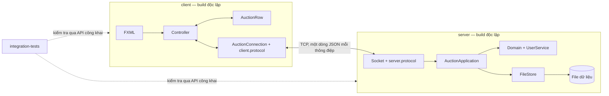
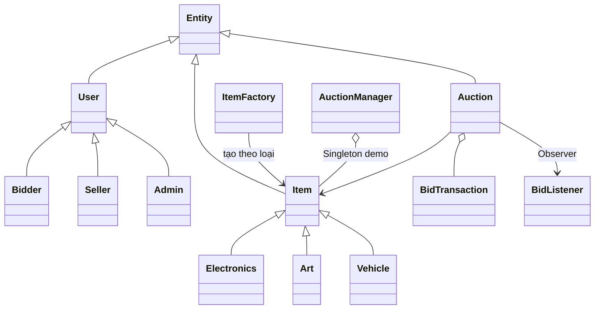

# Thiết kế hệ thống

## Hai ứng dụng và bộ kiểm thử chung

Mỗi ứng dụng có POM không có parent và không phụ thuộc artifact `com.example.auction`
của ứng dụng khác. POM gốc chỉ gom hai ứng dụng và `integration-tests` khi cần kiểm tra
cả hệ thống. Test tích hợp không được đóng gói vào JAR của server hoặc client.

Client giữ dữ liệu hiển thị (`AuctionRow`) và các form, không giữ domain entity hay DAO.
Không copy các lớp kiểm tra giá/chọn người thắng vào client. Các nút được ẩn theo vai trò
để dễ dùng, nhưng server vẫn kiểm quyền trên từng lệnh.

## Vì sao có hai bản protocol nhỏ?

Hai bên cần hiểu cùng một dạng JSON, không cần dùng chung class Java. Mỗi bên giữ Message,
JsonLines và hằng chuỗi riêng trong package của mình. Mã chỉ gồm envelope và framing; luật
đấu giá nằm ở server. Đổi wire contract phải cập nhật `protocol.md` và test hai bên, rồi
chạy test tích hợp. Cách này cho phép chép riêng thư mục client sang máy khác để build.

Module `common` cũ đã bỏ. Package domain `com.example.auction.common.model` còn nằm trong
server để đọc dữ liệu serialization cũ; đổi package ngay sẽ làm các snapshot đã lưu mất
khả năng đọc. Đây là quyết định tương thích dữ liệu, không phải một thư viện dùng chung.

## OOP và mẫu thiết kế

Entity cấp UUID. User/Item là lớp trừu tượng, các lớp con override getRole/getCategory/
printInfo. Dữ liệu đóng gói; lịch sử trả bản sao bất biến. ItemFactory tạo sản phẩm theo
loại. AuctionManager dùng holder để minh họa Singleton trong Demo. BidListener nối
Observer của domain với sự kiện giá ở tầng ứng dụng.

## Trạng thái và xử lý đồng thời

`OPEN → RUNNING → FINISHED → PAID/CANCELED`; OPEN/RUNNING cũng có thể bị hủy.
Không có người thắng thì không được PAID. Seller chỉ sửa/xóa nháp, Admin có quyền với mọi phiên.

Mỗi Auction dùng ReentrantLock. Kiểm trạng thái, thời gian, số tiền và ghi giá/leader/history
trong cùng khóa. Kiểm deadline ngay trong placeBid để không nhận bid trễ dù scheduler chưa
kịp chạy. Observer được gọi sau khi nhả khóa; một observer lỗi không làm mất bid đã ghi.

AuctionApplication sắp thứ tự command, lưu snapshot và phát event bằng synchronized.
Ghi file toàn bộ phù hợp dữ liệu nhỏ của BTL, nhưng làm giảm throughput khi nhiều phiên
cùng ghi. Không tuyên bố hệ thống hiện tại phục vụ tải thương mại lớn.

Server dùng thread pool thông thường, giới hạn 64 kết nối và hàng đợi gửi riêng cho mỗi
client. Client chậm bị ngắt khi hàng đợi đầy hoặc vượt 8 MiB dữ liệu mã hóa đang giữ, gồm frame đang ghi. Client nhận mạng ở luồng riêng, cập nhật GUI
qua Platform.runLater. Timer giao diện chỉ đếm ngược tại máy, không polling mạng.
requestId ghép phản hồi đúng yêu cầu; version ngăn snapshot cũ ghi đè giá mới. Chuỗi tải
history cũng kiểm version, không chỉ snapshot phiên. Phân trang dùng afterId để tránh
dịch offset khi có xóa. Khóa socket writer tách khỏi khóa close, nên mất mạng không chặn
GUI lúc đóng; callback mất mạng được lưu lại nếu nó xảy ra trước khi controller đăng ký.

## Auto-bid và anti-sniping

PriorityQueue sắp rule theo trần giảm dần, cùng trần thì thứ tự đăng ký tăng dần. Hai rule
đầu quyết định người dẫn và giá đủ vượt đối thủ, bị chặn tại trần người thắng. Nếu leader
không có rule còn hiệu lực thì thêm giá họ đã thực đặt như một ứng viên. Không cần lặp từng
bước giá đến trần; mã dùng các phép so sánh và cộng số nguyên thông thường. Mỗi giá trị
được giới hạn 10^15 nên tổng hai giá trị vẫn an toàn với long.

Bid trong 10 giây cuối đặt endTime thành now +30 giây. Thao tác này cùng khóa với giá.
Clock luôn đọc endTime mới, nên thời gian gia hạn không bị một timer cũ bỏ qua.

## Lưu trữ và lỗi

FileStore serialize tài khoản có hash mật khẩu, phiên và history/rule auto vào file cục bộ.
Listener transient được gắn lại khi load. Không dùng ObjectInputStream cho dữ liệu socket.
Object filter giới hạn kiểu/độ sâu/chiều dài mảng; file tạm được fsync rồi move nguyên tử, process lock
ngăn hai server ghi cùng thư mục. Ghi lỗi làm service ngừng nhận lệnh đến khi restart;
file hỏng không bị tự reset. DAO đã close không được ghi tiếp bằng đối tượng cũ.
Lỗi từng application observer được cách ly khỏi kết quả của lệnh đã commit. Mất phản hồi sau khi ghi vẫn có thể xảy ra, nên client không
tự gửi lại lệnh tạo phiên/đặt giá. Khi gặp tình huống đó cần tải lại để kiểm kết quả.

Mật khẩu dùng PBKDF2 + salt, không đưa hash vào JSON public. Socket demo chưa có TLS,
PAID chỉ là xác nhận mô phỏng. Nếu triển khai ngoài mạng tin cậy cần thiết kế thêm.
