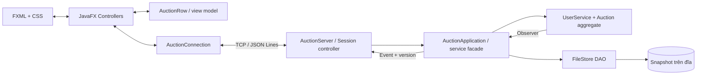
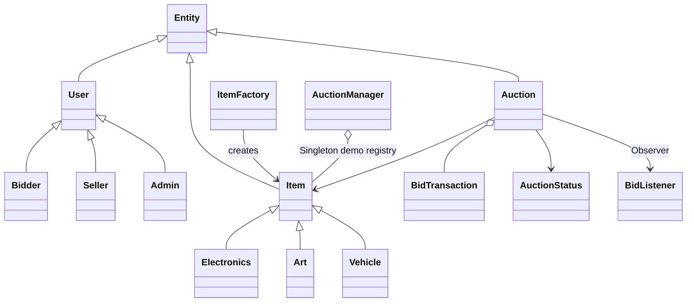
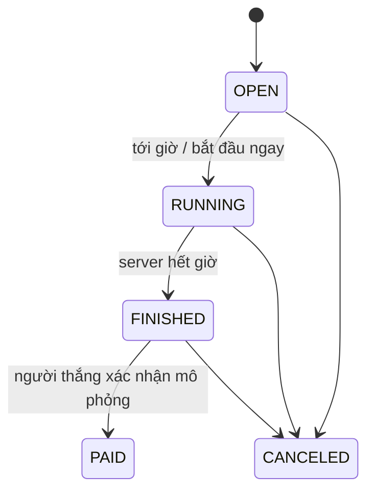

# Kiến trúc và quyết định thiết kế

## Thành phần

`common` chứa entity, trạng thái, exception và framing/protocol; `server` xử lý xác thực,
phân quyền, nghiệp vụ, lịch và lưu trữ; `client` không truy cập file dữ liệu của server.
Controller không tự xác định người thắng hoặc tự thay đổi giá: mọi kết quả đến từ server.

## Cây lớp

`Entity` cấp UUID. `User` và `Item` trừu tượng; lớp con override `getRole`, `getCategory`,
`printInfo`. Trường dữ liệu đóng gói, lịch sử trả bản sao bất biến. `ItemFactory` tập trung
khởi tạo từng loại sản phẩm. `AuctionManager` là Singleton khởi tạo lười theo holder,
được minh họa bởi `Demo`; danh tính phiên client được App quản lý theo vòng đời màn hình.

## Trạng thái

Giá và thời gian được kiểm tra **bên trong** khóa của phiên. Không chỉ dựa vào scheduler:
ngay tại endTime, một bid cũng bị từ chối dù clock chưa kịp đóng phiên.
Bắt đầu sớm giữ nguyên thời lượng thay vì giữ endTime cũ.

## Đồng thời và realtime

`Auction` có `ReentrantLock` riêng, lịch sử và currentPrice/leader được ghi nguyên tử.
Observer chạy sau khi nhả khóa. Lỗi một observer không làm lượt giá đã chấp nhận thất bại.
`AuctionApplication` sắp thứ tự các command + lưu snapshot + event bằng monitor chung để
snapshot nhất quán giữa tài khoản và phiên. Đây là lựa chọn đơn giản cho BTL; throughput
đa phiên bị giới hạn bởi việc ghi file tuần tự, dù từng domain aggregate có khóa riêng.

Server dùng virtual thread cho socket, một clock 100ms và hàng đợi outgoing có giới hạn
cho mỗi client. Client chậm bị ngắt thay vì giữ khóa nghiệp vụ. Client dùng requestId để
phân biệt phản hồi và sự kiện, timeout 10s, hủy pending khi mất mạng. JavaFX nhận dữ liệu
qua `Platform.runLater`; timer 1s chỉ đếm ngược cục bộ, **không polling mạng**.

Mỗi snapshot có version; snapshot cũ không thể ghi đè giá mới. SUBSCRIBE + snapshot được
xử lý cùng monitor ứng dụng, tránh khoảng trống giữa đọc và theo dõi. GUI còn nhận sự kiện
danh sách toàn cục để thấy phiên mới, đổi trạng thái và phiên bị xóa.

## Auto-bid

Mỗi người có `(maxBid, increment, registrationSequence)` được giữ riêng trên server.
PriorityQueue xếp theo maxBid giảm dần, cùng trần thì sequence nhỏ trước. Thêm người dẫn
hiện tại như đối thủ có trần bằng giá họ thực đặt nếu họ không còn rule auto hợp lệ.
Lấy hai ứng viên đầu, tính giá đủ để vượt đối thủ nhưng không vượt trần người thắng.
Không lặp từng đồng/bước giá đến trần: O(n log n), tránh vòng lặp hàng tỷ lần.
Bước khởi đầu cũng bị giới hạn bởi trần; lịch sử chỉ ghi giá thực được chấp nhận.

Anti-sniping dùng cùng khóa: nếu còn ≤10 giây, endTime thành now +30 giây. Clock luôn đọc
endTime mới nên timer cũ không thể đóng nhầm phiên vừa được gia hạn.

## Dữ liệu và lỗi

`FileStore.State` serialize users + auctions, bao gồm UUID, hash có salt, bid, trần auto,
trạng thái và timestamp. Listener là transient, gắn lại khi load; khóa được deserialize
ở trạng thái mở. Không nhận ObjectInputStream qua socket. File local có ObjectInputFilter,
version schema, giới hạn độ sâu/kích thước và process lock.

Mỗi mutation thành công chỉ được trả RESULT sau khi ghi snapshot xong. Ghi lỗi làm service
fail-stop với STORAGE_ERROR; phải sửa lỗi đĩa và restart để khôi phục trạng thái bền vững.
Snapshot hỏng không bị tự reset. Việc mất phản hồi sau khi đã ghi vẫn có thể xảy ra: client
phải tải lại để đối chiếu, không tự gửi lại bid/CREATE. Chưa có idempotency key xuyên restart.

Chọn file DAO thay database phù hợp yêu cầu Serialization/File I/O của hướng dẫn. Có thể
thay FileStore bằng JDBC sau này nhưng cần thiết kế giao dịch riêng, không chỉ đổi tên lớp.
