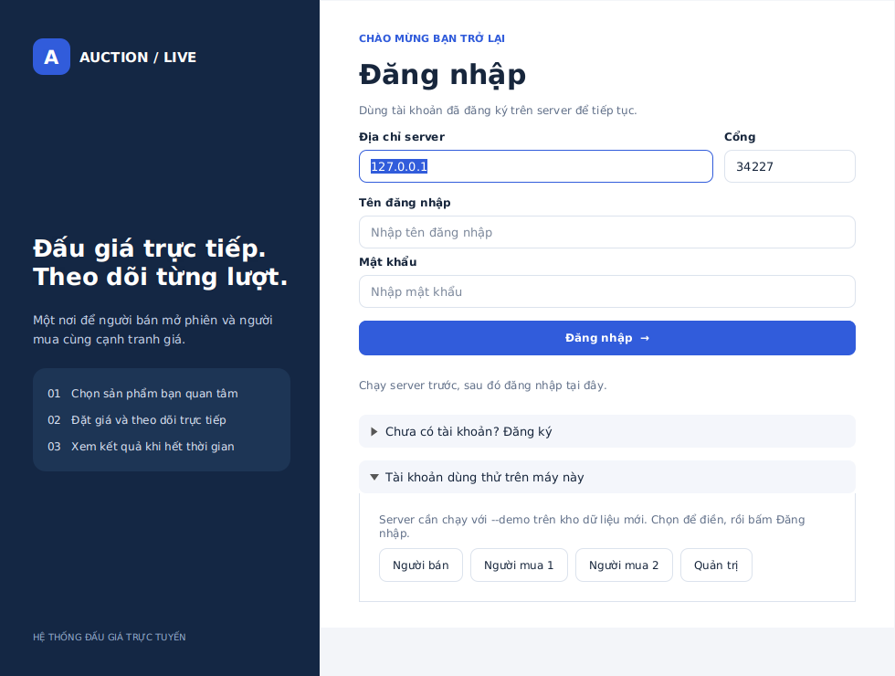
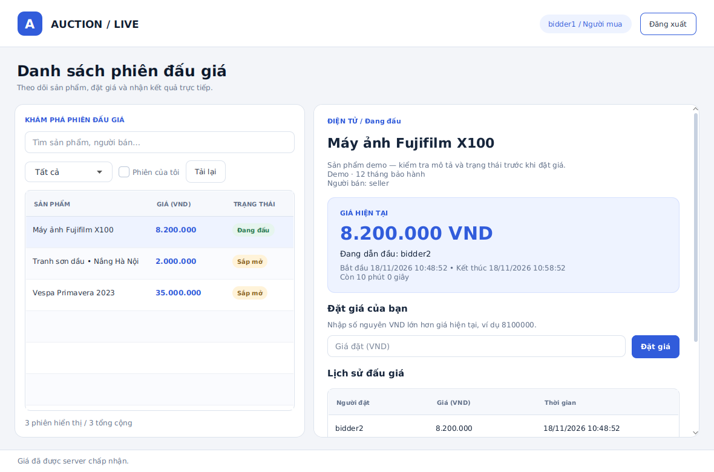

# Đối chiếu đề BTL và bằng chứng kiểm tra

Đối chiếu `Đề bài Bài tập lớn LTNC Hệ thống đấu giá trực tuyến 2026.pdf` và
`Hướng dẫn BTL LTNC-2026.pdf`. Hướng dẫn (trang 1, 6) xếp concurrency và realtime
Observer/Socket vào mục bắt buộc.
Phân công năm vai A–E theo [tài liệu kế hoạch](weekly.md).

| Yêu cầu | Vị trí triển khai | Bằng chứng |
|---|---|---|
| Entity, User và ba vai trò, Item và ba nhóm | server/src/.../common/model | Phân cấp abstract, override role/category/printInfo |
| OOP, đóng gói | Entity, Item, User, Auction | Trường private, lịch sử bất biến, Factory |
| Singleton / Factory Method / Observer | AuctionManager, ItemFactory, BidListener | Singleton mở kho và chạy server; ItemType override Factory Method; Observer phát giá thật. |
| Đăng ký/đăng nhập | UserService, AuctionServer.Session | Test đăng nhập, vai trò, trùng tài khoản, hash |
| Admin | AuctionApplication | Danh sách user không lộ hash, quản lý mọi phiên |
| CRUD sản phẩm | AuctionApplication + SellerController | Tạo/sửa/xóa nháp, giữ lịch khi sửa mô tả, phân quyền sửa/hủy/xóa |
| Đặt giá và người dẫn đầu | Auction.placeBid | Bid > giá hiện tại, số nguyên, không tự bid |
| Tự đóng, người thắng, lifecycle | tick, AuctionStatus | Đúng deadline, FINISHED/PAID/CANCELED, không PAID nếu không thắng |
| Xử lý lỗi | ApiException, domain exceptions, AuctionConnection | Dữ liệu sai, mất mạng, timeout, lỗi lưu, snapshot hỏng |
| JavaFX/FXML + MVC | client/resources + controllers | Test tải FXML, login/bid thật, ảnh chụp từ test |
| Concurrency | Auction lock + service command monitor | 100 luồng lặp 100 lần; 12 socket đồng thời |
| Realtime qua Socket | AuctionServer + AuctionConnection | Hai client, server đẩy, version, lịch sử trên GUI cập nhật |
| Lưu/tải serialization | FileStore | Atomic save, process lock, restart giữ người dùng, phiên và lịch sử |
| Maven / coding convention | POM riêng server/client | Chép từng ứng dụng ra ngoài vẫn build/test được; Checkstyle 0 vi phạm |
| JUnit / coverage ≥60% | */src/test + JaCoCo | Đã đo và kiểm ngưỡng cả GUI |
| GitHub Actions | .github/workflows/ci.yml | Hai job build độc lập và job tích hợp; trạng thái remote xem ở Actions |
| Tài liệu, báo cáo, demo | README + docs | Hướng dẫn chạy, giao thức, kiến trúc, báo cáo, slide |

## Kiểm thử sau rà soát để đưa lên GitHub

- `mvn -B -ntp clean verify`: 159 lượt (143 server, 10 client, 6 tích hợp), 0 lỗi,
  0 lượt bị bỏ qua và 0 vi phạm Checkstyle.
- JaCoCo: 1539/1752 dòng (87,8%). Build server/client độc lập và kiểm tra ranh giới JAR đều đạt.
- Smoke test JAR: năm socket, hai người đặt giá, sự kiện realtime, tự đóng, thanh toán mô phỏng
  và đọc lại phiên sau khi khởi động lại. Bản sao snapshot demo cũ vẫn tải được.
- Các kiểm thử hồi quy mới bao gồm form sửa cũ, giới hạn giá khởi điểm, phiên quá hạn sau khi
  mở lại và thứ tự thời gian của bảng lịch sử. Xem [chi tiết rà soát](audit.md).

## Kiểm thử khi đóng gói bản bàn giao A–E lần đầu

- `mvn -B -ntp clean verify`: 155 lượt kiểm thử (140 server, 10 client, 5 tích hợp),
  0 lỗi, 0 bỏ qua và 0 vi phạm Checkstyle.
- JaCoCo tổng 1518/1737 dòng (87,4%), trên ngưỡng 60% của hướng dẫn.
- Kiểm thử tích hợp mở JavaFX bằng Monocle và dùng server thật. Seller tạo, sửa và xóa
  phiên. Admin mở danh sách tài khoản. Hai bidder nhận giá và lịch sử qua Socket.
- Kiểm tra độc lập từng module và đường chạy từ ZIP dùng lệnh trong
  [hướng dẫn terminal](local-demo.md). Các thông số trên áp dụng cho bản local bàn giao.

## Kết quả trước khi rà đủ năm vai ngày 18/11/2026

- `mvn -B -ntp clean verify` đạt 150 lượt kiểm thử (136 server, 10 client, 4 tích hợp),
  không lỗi hoặc bỏ qua. Checkstyle ghi nhận 0 vi phạm.
- `python3 scripts/check_architecture.py` và `bash scripts/check_independent_builds.sh`
  xác nhận hai ứng dụng build riêng, không đóng gói mã của ứng dụng còn lại.
- `python3 scripts/check_coverage.py` đo 1400/1713 dòng (81,7%), vượt ngưỡng 60%.
- `python3 scripts/smoke.py` chạy JAR thật với năm socket, đấu giá, cập nhật sự kiện,
  tự đóng, thanh toán mô phỏng và kiểm tra dữ liệu sau khi khởi động lại.
- Ảnh JavaFX từ test tích hợp gồm cửa sổ 1000×700. Kiểm tra lưu trữ dùng bản sao dữ liệu
  demo và snapshot thử của phiên bản trước. GitHub Actions được cấu hình để chạy khi push.

## Kết quả audit trước đợt sửa giao diện (ac2b632)

Số liệu dưới đây thuộc lần audit cũ. Kết quả đợt sửa UI ngày 15/11/2026 nằm ở
[ui-validation.json](ui-validation.json); phạm vi và giới hạn ở
[review-and-references.md](review-and-references.md).

Lệnh cuối `mvn -B -ntp verify` (kèm settings cloud) hoàn thành **BUILD SUCCESS**:

| Module | Lượt test | Fail / Error / Skip | Coverage dòng |
|---|---:|---|---:|
| server | 138 | 0 / 0 / 0 | 833/929 = 89,7% |
| client | 10 | 0 / 0 / 0 | 494/724 = 68,2% |
| integration-tests | 3 | 0 / 0 / 0 | Gộp phần thực thi vào server/client |
| **Tổng** | **151** | **0 / 0 / 0** | **1327/1653 = 80,3%** |

151 là số **lượt thực thi**, gồm test cạnh tranh được lặp 100 lần; không phải 151 phương thức
test độc lập. Không loại GUI hoặc lớp nghiệp vụ khỏi báo cáo để tăng coverage.
Checkstyle Google có **0 vi phạm** ở các project. Coverage lấy từ báo cáo aggregate,
gồm test riêng của mỗi ứng dụng và test tích hợp, không cộng trùng cùng một dòng code.

`python3 scripts/smoke.py` cũng PASS trên JAR thật: login, CRUD, hai bidder, auto-bid,
sự kiện tự đóng, xác nhận mô phỏng, restart tiến trình và kiểm dữ liệu giữ nguyên.
Test bao gồm lịch sử 105 lượt với phân trang, IO ghi thất bại fail-stop, biên max auto-bid
và update nháp thiếu dữ liệu. Test client riêng kiểm phản hồi đến sai thứ tự và socket đóng
giữa chừng, không import server.

`bash scripts/check_independent_builds.sh` ở lần audit đó chạy trên cấu trúc Maven trước khi
đổi thành `common/server/client`. Kết quả lịch sử không mô tả cấu trúc hiện tại.

Đã thử server mới với **bản sao** snapshot demo của phiên bản trước: load thành công,
đăng nhập tài khoản đã có và đọc lại danh sách; không sửa file dữ liệu gốc.

Ảnh giao diện hiện tại lấy từ kiểm thử JavaFX với server thật.

## Kiểm tra lỗi bổ sung

Xem [audit.md](audit.md): các lỗi tìm được, test thất bại trước sửa, bản sửa và phạm vi
kiểm tra. Bổ sung kiểm lỗi giao thức, write bị chặn, callback mất mạng, observer lỗi,
phân trang khi xóa, dữ liệu history đến trễ, DAO đã đóng và mảng serialization quá lớn.
Thử thêm 24 client đồng thời, 400 bid với peer không đọc, 50 sản phẩm Unicode lớn,
4.000 thao tác theo seed cố định và 50 cuộc đua giữa bid/đóng phiên. Test tăng thêm là
để bắt các tình huống cụ thể; coverage cao không chứng minh dự án không còn lỗi.

## Bàn giao phần kỹ thuật theo năm vai

| Vai | Hạng mục đã có trong gói | Cách kiểm tra |
|---|---|---|
| A — Domain và mẫu thiết kế | Cây lớp User/Item, AuctionManager Singleton, Factory Method theo loại, Observer | Test tạo ba loại Item, đăng nhập vào server do Singleton khởi động, nhận sự kiện từ client thứ hai |
| B — Đấu giá và đa luồng | Đặt giá, kiểm thời gian, khóa, người dẫn đầu, tự đóng, người thắng và ngoại lệ | Test giá sai, bid sát hạn, nhiều luồng và nhiều Socket, khởi động lại giữ kết quả |
| C — Server, mạng và dữ liệu | Socket JSON, đăng ký/đăng nhập, quyền, cập nhật trực tiếp và lưu file | Test giao thức, đăng nhập đồng thời, khôi phục snapshot và smoke test JAR |
| D — JavaFX/FXML và mạng client | Đăng ký/đăng nhập, danh sách, chi tiết, đặt giá và lịch sử trực tiếp | Test JavaFX/FXML với server thật, hai bidder, báo lỗi khi mất kết nối |
| E — Build, test và GUI phụ | Maven, Checkstyle, JaCoCo, workflow GitHub Actions, Seller CRUD và Admin | Build độc lập, test Seller tạo/sửa/xóa qua GUI, test Admin mở danh sách tài khoản |

Gói dùng ba module Maven: `common`, `server`, `client`. Mô hình nằm trong common; DAO và
service nằm ở server. Hai bên giao tiếp JSON theo cùng tài liệu giao thức. Test GUI tích hợp
nằm trong test scope của client, không được đóng gói trong ứng dụng chạy.

Tài liệu nhóm yêu cầu biểu đồ lớp tự vẽ ở commit đầu. Commit `d91006b` của repo này chỉ có
README. Nhóm cần xác nhận cách trình bày hồ sơ sơ đồ gốc, đóng góp và PR theo lịch sử thật.
Workflow có trong gói; kết quả chạy trên GitHub và tag phát hành thuộc một lần phát hành thật.

## Phần cần người nộp thực hiện

- Đọc và giải thích được toàn bộ code; tập demo trên máy sẽ trình bày.
- Điền thông tin môn học/nhóm vào báo cáo, điều chỉnh slide theo thời lượng thực tế.
- Kiểm tra run GitHub Actions thật sau push, tiếp tục ghi nhận đóng góp thực tế khi nhóm làm tiếp.
- Lịch sử commit, trình bày và điểm chấm không thể được thay thế bởi một lượt triển khai.
- PAID là mô phỏng, Socket demo chưa có TLS; không mô tả đây là dịch vụ thương mại hoàn chỉnh.
