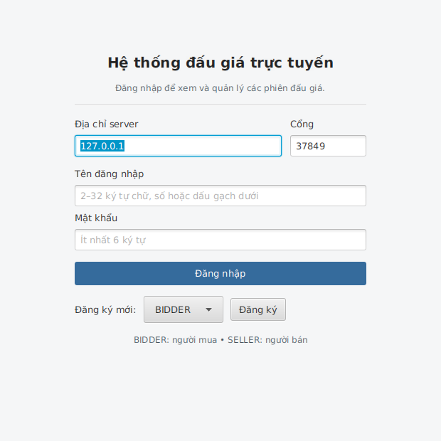
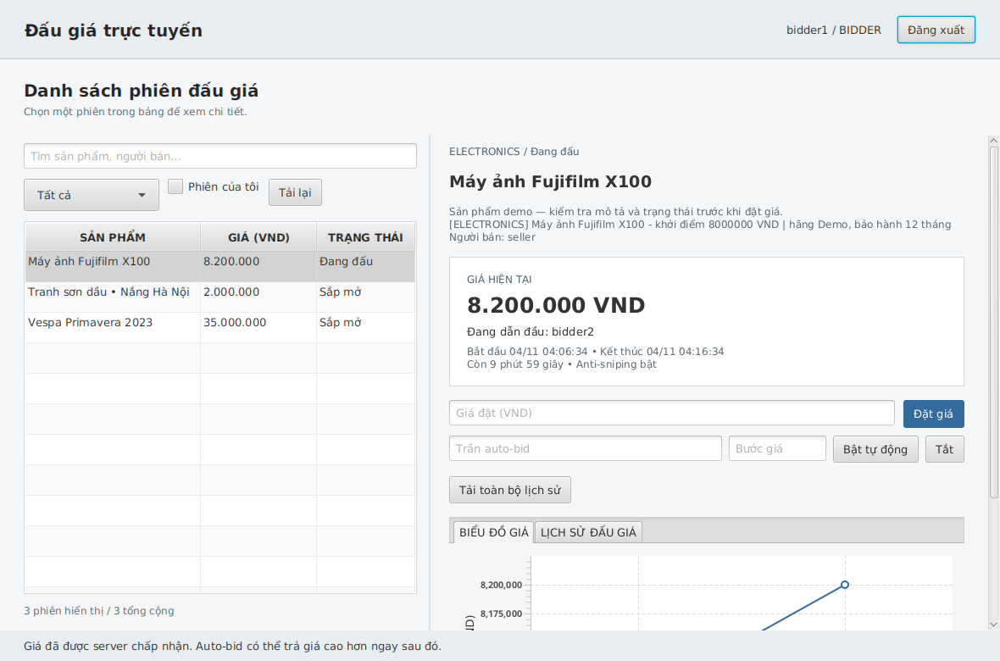

# Đối chiếu đề BTL và bằng chứng kiểm tra

Đối chiếu `2026-BTL (1).pdf`, `Hướng dẫn BTL LTNC-2026.pdf` và kế hoạch dự án đã cung cấp.
Phân công bốn mảng theo `weekly.md`; thay đổi đã làm và commit được ghi ở `development-log.md`.

| Yêu cầu | Vị trí triển khai | Bằng chứng |
|---|---|---|
| Entity, User và ba vai trò, Item và ba nhóm | server/src/.../common/model | Phân cấp abstract, override role/category/printInfo |
| OOP, đóng gói | Entity, Item, User, Auction | Trường private, lịch sử bất biến, Factory |
| Singleton / Factory / Observer | AuctionManager, ItemFactory, BidListener | Demo Singleton, tạo sản phẩm thật qua Factory, sự kiện bid thật |
| Đăng ký/đăng nhập | UserService, AuctionServer.Session | Test đăng nhập, vai trò, trùng tài khoản, hash |
| Admin | AuctionApplication | Danh sách user không lộ hash, quản lý mọi phiên |
| CRUD sản phẩm | AuctionApplication + SellerController | Tạo/sửa/xóa nháp, ownership, khóa sửa khi đang chạy |
| Đặt giá và người dẫn đầu | Auction.placeBid | Bid > giá hiện tại, số nguyên, không tự bid |
| Tự đóng, người thắng, lifecycle | tick, AuctionStatus | Đúng deadline, FINISHED/PAID/CANCELED, không PAID nếu không thắng |
| Xử lý lỗi | ApiException, domain exceptions, AuctionConnection | Dữ liệu sai, mất mạng, timeout, lỗi lưu, snapshot hỏng |
| JavaFX/FXML + MVC | client/resources + controllers | Test tải FXML, login/bid thật, ảnh chụp từ test |
| Concurrency | Auction lock + service command monitor | 100 luồng lặp 100 lần; 12 socket đồng thời |
| Realtime qua Socket | AuctionServer + AuctionConnection | Hai client, server đẩy, version, GUI/biểu đồ cập nhật |
| Lưu/tải serialization | FileStore | Atomic save, process lock, restart giữ người dùng/phiên/auto-bid |
| Maven / coding convention | POM riêng server/client | Chép từng ứng dụng ra ngoài vẫn build/test được; Checkstyle 0 vi phạm |
| JUnit / coverage ≥60% | */src/test + JaCoCo | Đã đo và kiểm ngưỡng cả GUI |
| GitHub Actions | .github/workflows/ci.yml | Hai job build độc lập và job tích hợp; trạng thái remote xem ở Actions |
| Auto-bid | Auction.resolveAutoBids | PriorityQueue, cap, increment, hòa trần, lưu rule |
| Anti-sniping | Auction.accept | Trong 10s cuối gia hạn còn 30s, test endTime |
| Biểu đồ realtime | MainController.chart | Nhận bid từ socket thứ hai, kiểm số điểm chart |
| Tài liệu, báo cáo, demo | README + docs | Hướng dẫn chạy, giao thức, kiến trúc, báo cáo, slide |

## Kết quả tại môi trường hiện tại

Lệnh cuối `mvn -B -ntp verify` (kèm settings cloud) hoàn thành **BUILD SUCCESS**:

| Module | Lượt test | Fail / Error / Skip | Coverage dòng |
|---|---:|---|---:|
| server | 138 | 0 / 0 / 0 | 833/929 = 89,7% |
| client | 10 | 0 / 0 / 0 | 494/724 = 68,2% |
| integration-tests | 3 | 0 / 0 / 0 | Gộp phần thực thi vào server/client |
| **Tổng** | **151** | **0 / 0 / 0** | **1327/1653 = 80,3%** |

151 là số **lượt thực thi**, gồm test cạnh tranh được lặp 100 lần; không phải 151 phương thức
test độc lập. Không loại GUI hoặc lớp nghiệp vụ khỏi báo cáo để tăng coverage.
Checkstyle Google có **0 vi phạm** ở các project. Coverage lấy từ báo cáo aggregate,
gồm test riêng của mỗi ứng dụng và test tích hợp, không cộng trùng cùng một dòng code.

`python3 scripts/smoke.py` cũng PASS trên JAR thật: login, CRUD, hai bidder, auto-bid,
sự kiện tự đóng, xác nhận mô phỏng, restart tiến trình và kiểm dữ liệu giữ nguyên.
Test bao gồm lịch sử 105 lượt với phân trang, IO ghi thất bại fail-stop, biên max auto-bid
và update nháp thiếu dữ liệu. Test client riêng kiểm phản hồi đến sai thứ tự và socket đóng
giữa chừng, không import server.

`bash scripts/check_independent_builds.sh` PASS: sao chép **chỉ** source/POM của server rồi
client ra thư mục tạm và chạy clean verify, không có POM gốc hay mã ứng dụng kia.
`check_architecture.py` PASS: hai POM không có parent/phụ thuộc app nội bộ; JAR server không
chứa JavaFX/client, JAR client không chứa server/domain/DAO.

Đã thử server mới với **bản sao** snapshot demo của phiên bản trước: load thành công,
đăng nhập tài khoản đã có và đọc lại danh sách; không sửa file dữ liệu gốc.

## Kiểm tra lỗi bổ sung

Xem [audit.md](audit.md): các lỗi tìm được, test thất bại trước sửa, bản sửa và phạm vi
kiểm tra. Bổ sung kiểm lỗi giao thức, write bị chặn, callback mất mạng, observer lỗi,
phân trang khi xóa, dữ liệu history đến trễ, DAO đã đóng và mảng serialization quá lớn.
Thử thêm 24 client đồng thời, 400 bid với peer không đọc, 50 sản phẩm Unicode lớn,
4.000 thao tác theo seed cố định và 50 cuộc đua giữa bid/đóng phiên. Test tăng thêm là
để bắt các tình huống cụ thể; coverage cao không chứng minh dự án không còn lỗi.

## Phần cần người nộp thực hiện

- Đọc và giải thích được toàn bộ code; tập demo trên máy sẽ trình bày.
- Điền thông tin môn học/nhóm vào báo cáo, điều chỉnh slide theo thời lượng thực tế.
- Kiểm tra run GitHub Actions thật sau push, tiếp tục ghi nhận đóng góp thực tế khi nhóm làm tiếp.
- Lịch sử commit, trình bày và điểm chấm không thể được thay thế bởi một lượt triển khai.
- PAID là mô phỏng, Socket demo chưa có TLS; không mô tả đây là dịch vụ thương mại hoàn chỉnh.
